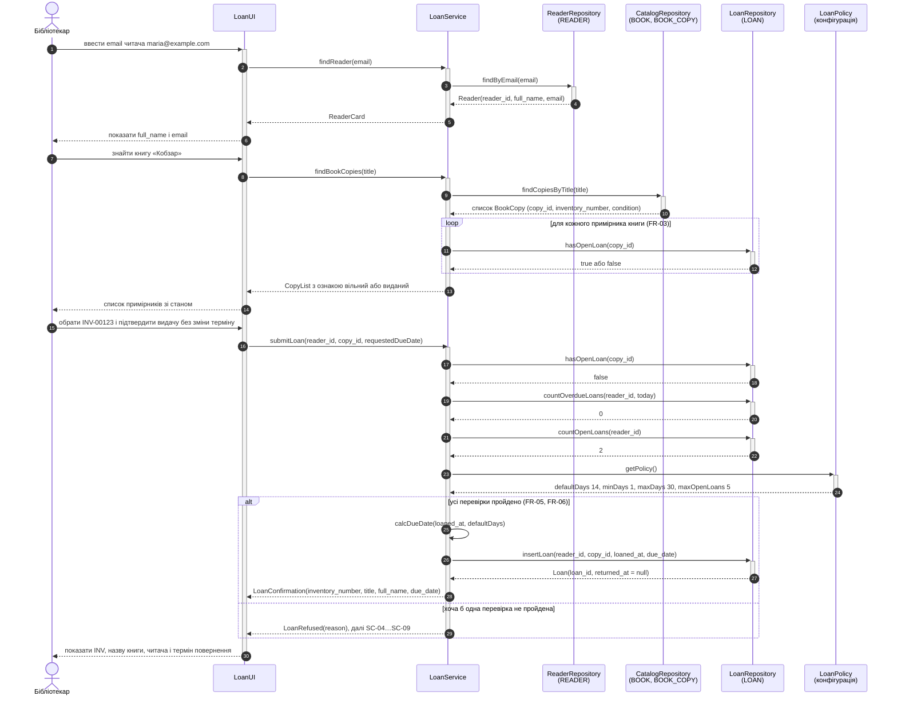
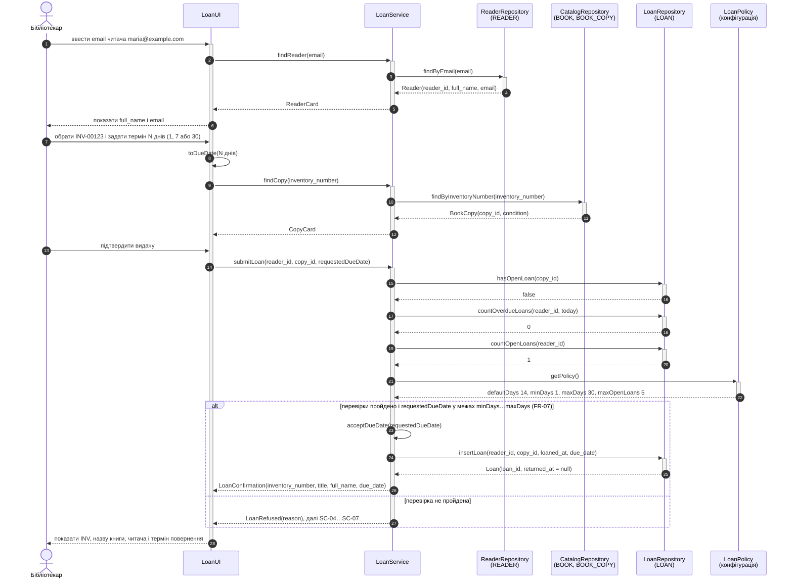
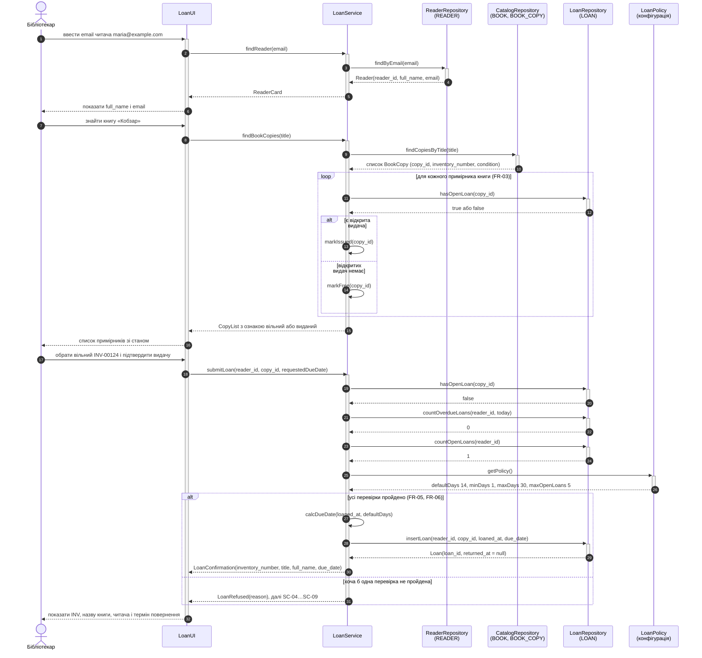
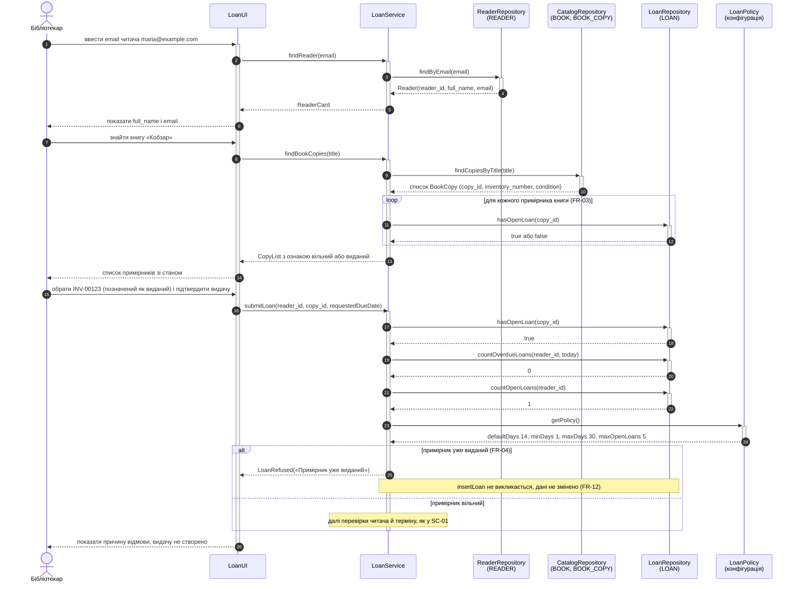
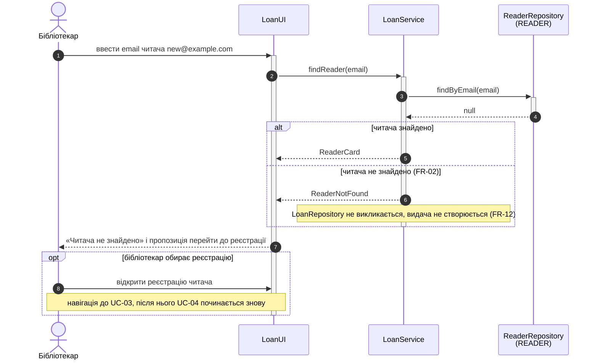
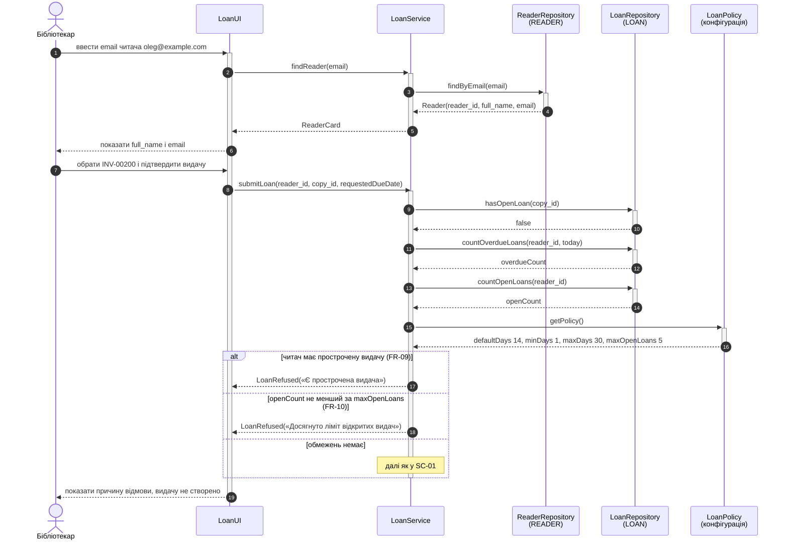
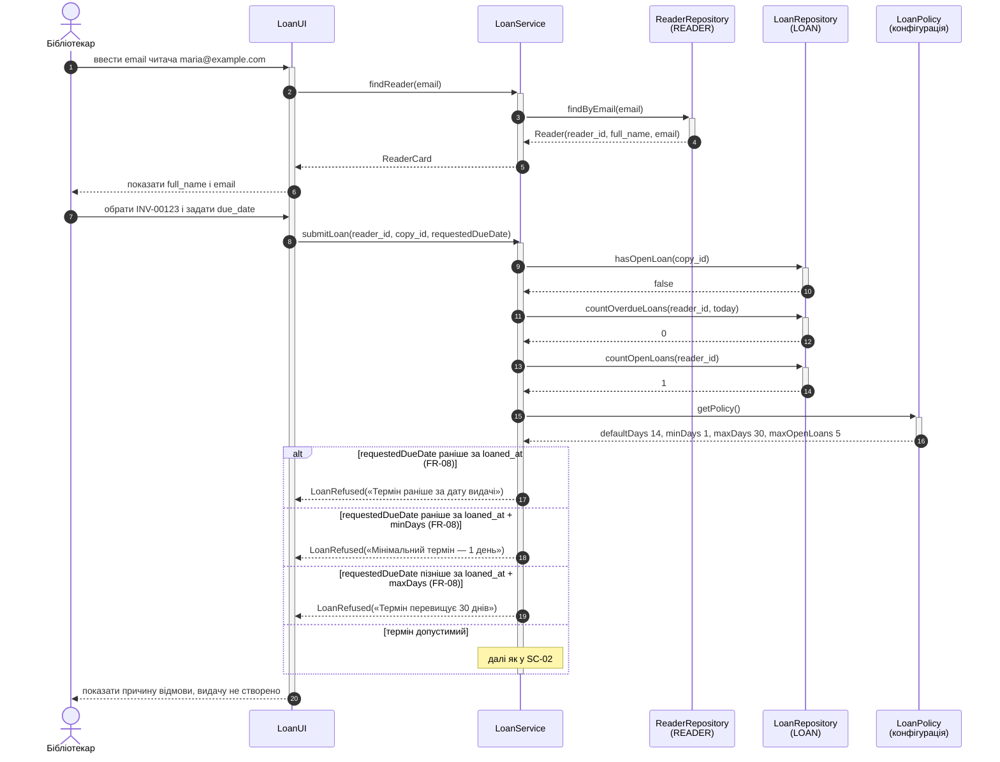
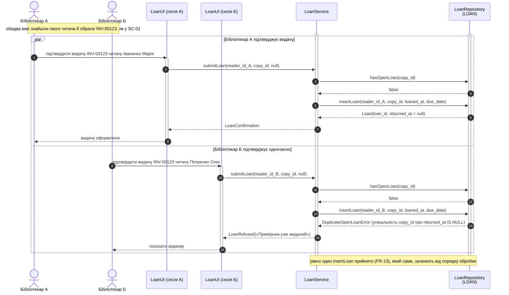
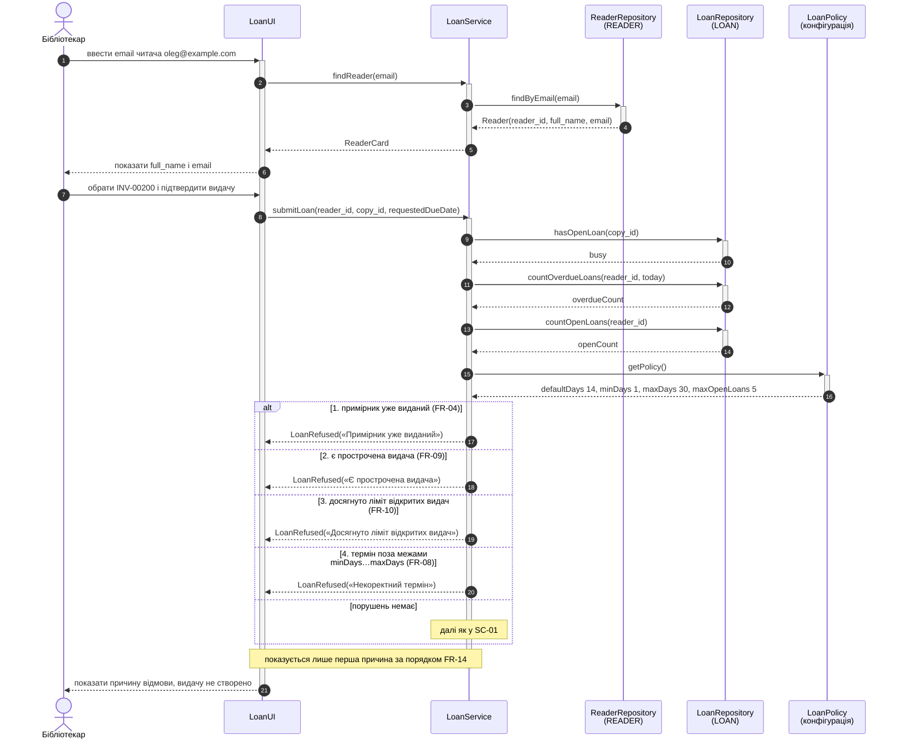

# Специфікація: sequence-діаграми для UC-04 «Оформити видачу примірника читачу»

Базується на Завданні 2 (UC-04, сценарії SC-01…SC-09, вимоги FR-01…FR-14) і на ER-моделі із Завдання 1 (AUTHOR, PUBLISHER, CATEGORY, BOOK, BOOK_COPY, READER, LOAN). Діаграми описують, що відбувається всередині системи в кожному сценарії; учасники — лише ті, що беруть участь у цьому UC, а не вся система. Діаграми написано в Mermaid `sequenceDiagram`: GitHub відмальовує їх у цьому файлі, вихідний код лежить у `diagrams/sc-0N.mmd`, готовий рендер — `diagrams/sc-0N.svg`.

## 1. UC і його сценарії (із Завдання 2)

**UC-04 «Оформити видачу примірника читачу».** Первинний актор — Бібліотекар. Мета: передати читачу конкретний примірник і зафіксувати це записом LOAN.

| Сценарій | Назва | Тип | Вимоги | Фрагменти на діаграмі |
|---|---|---|---|---|
| SC-01 | Успішна видача зі стандартним терміном | основний | FR-01, 03, 05, 06, 11 | alt, loop |
| SC-02 | Видача з індивідуальним терміном | альтернативний | FR-01, 05, 07, 11 | alt |
| SC-03 | Вибір вільного примірника серед кількох | альтернативний | FR-01, 03, 05, 06, 11 | loop + alt, alt |
| SC-04 | Примірник уже виданий | відмова | FR-01, 03, 04, 12 | alt, loop |
| SC-05 | Читача не знайдено | відмова | FR-01, 02, 12 | alt, opt |
| SC-06 | Порушення політики (прострочення, ліміт) | відмова | FR-01, 09, 10, 12 | alt |
| SC-07 | Некоректний термін | відмова | FR-01, 08, 12 | alt |
| SC-08 | Одночасні підтвердження | відмова (змагання) | FR-01, 04, 05, 12, 13 | par |
| SC-09 | Пріоритет причин відмови | відмова | FR-04, 08, 09, 10, 14 | alt |

## 2. Учасники діаграм і зв'язок з ER

| Учасник | Тип | Що представляє | Сутність / джерело в ER |
|---|---|---|---|
| Бібліотекар (`L`) | актор | працівник біля стійки | **немає сутності** (STAFF відсутня) |
| LoanUI (`UI`) | межа системи | екран оформлення видачі | не сутність, інтерфейс |
| LoanService (`LS`) | сервіс | бізнес-логіка UC-04 (перевірки, розрахунок терміну) | не сутність, реалізує FR-04…FR-14 |
| ReaderRepository (`RR`) | репозиторій | доступ до читачів | READER (`reader_id`, `full_name`, `email`) |
| CatalogRepository (`CR`) | репозиторій | доступ до книг і примірників | BOOK (`title`), BOOK_COPY (`copy_id`, `inventory_number`, `condition`) |
| LoanRepository (`LR`) | репозиторій | доступ до видач | LOAN (`loan_id`, `reader_id`, `copy_id`, `loaned_at`, `due_date`, `returned_at`) |
| LoanPolicy (`LP`) | конфігурація | 14 днів, 1–30 днів, ліміт 5 | **немає сутності** (параметри політики) |

У SC-08 два екземпляри UI (сесії А і Б) і два бібліотекарі, бо подія — одночасність.

## 3. Діаграми по сценаріях

### SC-01. Успішна видача зі стандартним терміном (основний)

**Кроки:**
1. Бібліотекар вводить email → `findReader` → `findByEmail` → `ReaderCard` (FR-01)
2. Знаходить книгу «Кобзар» → `findBookCopies`; у циклі для кожного примірника `hasOpenLoan` (FR-03); система показує INV-00123 вільним
3. Підтверджує видачу без терміну → `submitLoan`: перевірки `hasOpenLoan`, `countOverdueLoans`, `countOpenLoans`, `getPolicy`
4. Усе гаразд → `calcDueDate` (+14 днів, FR-06) → `insertLoan` (FR-05) → `LoanConfirmation` (FR-11)

Фрагменти: alt, loop. Файли: `diagrams/sc-01.mmd`, `diagrams/sc-01.svg`.

### SC-02. Видача з індивідуальним терміном повернення (альтернативний)

**Кроки:**
1. Пошук читача, як у SC-01 (FR-01)
2. Бібліотекар обирає INV-00123 і задає термін N днів; UI перетворює його на дату (`toDueDate`), `findCopy` повертає `copy_id`
3. `submitLoan` із `requestedDueDate`; ті самі перевірки
4. Термін у межах minDays…maxDays → `acceptDueDate` (FR-07) → `insertLoan` → підтвердження

Фрагменти: alt. Файли: `diagrams/sc-02.mmd`, `diagrams/sc-02.svg`.

### SC-03. Вибір вільного примірника серед кількох (альтернативний)

**Кроки:**
1. Пошук читача (FR-01)
2. `findBookCopies`; у циклі для кожного примірника `hasOpenLoan`, у вкладеному alt: INV-00123 → `markIssued`, INV-00124 → `markFree` (FR-03)
3. Бібліотекар обирає вільний INV-00124 і підтверджує → перевірки → `calcDueDate` → `insertLoan` → підтвердження

Фрагменти: loop + alt, alt. Файли: `diagrams/sc-03.mmd`, `diagrams/sc-03.svg`.

### SC-04. Відмова: примірник уже виданий (відмова)

**Кроки:**
1. Пошук читача, список примірників; INV-00123 позначено виданим
2. Бібліотекар усе одно обирає його й підтверджує → `submitLoan` → `hasOpenLoan` повертає `true`
3. `LoanRefused(«Примірник уже виданий»)` (FR-04); `insertLoan` не викликається, дані не змінено (FR-12)

Фрагменти: alt, loop. Файли: `diagrams/sc-04.mmd`, `diagrams/sc-04.svg`.

### SC-05. Відмова: читача не знайдено (відмова)

**Кроки:**
1. `findReader` → `findByEmail` повертає `null`
2. `ReaderNotFound` (FR-02); `LoanRepository` не викликається (FR-12)
3. Бібліотекар може перейти до реєстрації (UC-03) — лише навігація

Фрагменти: alt, opt. Файли: `diagrams/sc-05.mmd`, `diagrams/sc-05.svg`.

### SC-06. Відмова через політику видачі (відмова)

**Кроки:**
1. Пошук читача; `submitLoan` для вільного INV-00200
2. `countOverdueLoans` і `countOpenLoans`, `getPolicy`
3. Є прострочена видача → відмова (FR-09); інакше `openCount` ≥ `maxOpenLoans` → відмова (FR-10)

Фрагменти: alt. Файли: `diagrams/sc-06.mmd`, `diagrams/sc-06.svg`.

### SC-07. Відмова: некоректний термін повернення (відмова)

**Кроки:**
1. Пошук читача; `submitLoan` із `requestedDueDate`
2. Інші перевірки пройдено; alt із трьома відмовами за терміном: раніше `loaned_at`, менше 1 дня, більше 30 днів (FR-08)

Фрагменти: alt. Файли: `diagrams/sc-07.mmd`, `diagrams/sc-07.svg`.

### SC-08. Відмова: одночасні підтвердження одного примірника (відмова (змагання))

**Кроки:**
1. Двоє бібліотекарів із різних сесій UI підтверджують видачу INV-00123 одночасно (`par`)
2. Обидва `hasOpenLoan` повертають `false`; перший `insertLoan` проходить
3. Другий `insertLoan` повертає `DuplicateOpenLoanError` (унікальність відкритої видачі), `LoanService` показує «Примірник уже виданий» (FR-13, FR-04)

Фрагменти: par. Файли: `diagrams/sc-08.mmd`, `diagrams/sc-08.svg`.

### SC-09. Пріоритет причин відмови (відмова (кілька причин))

**Кроки:**
1. Усі дані для перевірок отримано (`hasOpenLoan`, `countOverdueLoans`, `countOpenLoans`, `getPolicy`)
2. alt перевіряє причини за порядком FR-14: зайнятий примірник → прострочена видача → ліміт → термін
3. Показується лише перша причина (FR-14)

Фрагменти: alt. Файли: `diagrams/sc-09.mmd`, `diagrams/sc-09.svg`.

## 4. Аудит

### 4.1 Учасники ↔ ER-модель (Завдання 1)

| Перевірка | Результат |
|---|---|
| READER, BOOK, BOOK_COPY, LOAN представлені репозиторіями; атрибути в повідомленнях (`reader_id`, `full_name`, `email`, `copy_id`, `inventory_number`, `condition`, `title`, `loaned_at`, `due_date`, `returned_at`) існують у моделі | збігається |
| Сутності PUBLISHER, AUTHOR, CATEGORY у цьому UC не беруть участі | коректно, на діаграмах їх немає |
| Доступність і «прострочено» не зберігаються, а обчислюються (`hasOpenLoan`, `countOverdueLoans`) | узгоджено з AC-3 |
| Актор Бібліотекар, LoanPolicy | **не мають сутностей у ER** (розбіжності №1 і №2) |
| LoanUI, LoanService | архітектурні учасники, у моделі даних їх не повинно бути |

### 4.2 Кроки ↔ Gherkin-сценарії (Завдання 2)

| Сценарій | Збігається | Відхилення від Gherkin |
|---|---|---|
| SC-01 | пошук читача, список примірників, видача зі строком 14 днів, підтвердження | перевірки `hasOpenLoan` тощо виконуються в `submitLoan` — у Gherkin їх немає як кроків, але вони випливають з Given |
| SC-02 | вибір примірника, термін, видача | додано внутрішній крок `toDueDate` (UI) і `findCopy` — Gherkin їх не описує |
| SC-03 | список із вільним і виданим, вибір вільного | `markIssued`/`markFree` — внутрішні кроки |
| SC-04 | відмова «Примірник уже виданий», нова видача не створюється | Gherkin додає перевірку «кількість відкритих видач дорівнює 1» — на діаграмі це тестова перевірка, окремого кроку немає |
| SC-05 | пошук без результату, пропозиція реєстрації, видача не створюється | пропозиція реєстрації показана як `opt` (бібліотекар може не перейти) |
| SC-06 | прострочення й ліміт (5 і 6 видач) | діаграма одна на обидві причини |
| SC-07 | три повідомлення про термін | узгоджено |
| SC-08 | одна видача, друга відмова | на діаграмі є `DuplicateOpenLoanError`, якого в Gherkin немає (розбіжність №3) |
| SC-09 | пріоритет причин | діаграма показує всі чотири причини, Gherkin лише три приклади |

### 4.3 Activation bars

Перевірено скриптом (власним, не засобом Mermaid) і візуально на рендері SC-01 і SC-08:
- Кожна `activate` має відповідну `deactivate`, у кінці діаграми активних учасників немає.
- У гілках `alt`/`else`/`and` немає активації, що починається поза фрагментом і закінчується всередині. Усі короткі виклики репозиторіїв (`->>+` / `-->>-`) відкриваються й закриваються в тій самій гілці.
- LoanService, що працює і поза фрагментом, і в кількох гілках, активується до `alt`/`par` і деактивується після `end`; те саме для LoanRepository у SC-08.
- LoanUI активна від першого повідомлення до останнього.

### 4.4 ТОП-3 розбіжності та усунення

1. **LoanPolicy і Бібліотекар не мають опори в ER.** Параметри 14/1–30/5 беруться з `getPolicy()`, а в моделі для них немає ні сутності, ні атрибутів. *Усунення:* тримати політику в конфігурації (поза ER) і підтвердити значення в бібліотеки або додати сутність налаштувань.
2. **Немає сутності персоналу.** Бібліотекар виконує кожну діаграму, але `insertLoan` не передає, хто видав, бо LOAN не має `staff_id`; аутентифікація (Background у Gherkin) і журнал NFR-08 на діаграмах відсутні. *Усунення:* додати STAFF і `staff_id` у LOAN, тоді з'являться учасники AuthService і AuditLog.
3. **SC-04 і SC-08 покладаються на обмеження, якого немає в ER.** `DuplicateOpenLoanError` виникає лише якщо в БД є частковий унікальний індекс `UNIQUE(copy_id) WHERE returned_at IS NULL` (NFR-14), а Gherkin SC-08 про цю помилку не згадує. Без індексу два паралельні `insertLoan` обидва пройдуть. *Усунення:* зафіксувати індекс у специфікації й додати внутрішній крок до Gherkin SC-08 або залишити як деталь реалізації.

### 4.5 Що аудит не покриває

- Діаграми відрендерено mermaid-cli, але перевірка їх відповідності Gherkin виконана вручну, автоматичної немає.
- UC-04 включає UC-01 (include): на діаграмах це показано кроком `findBookCopies`, окремого фрагмента для UC-01 немає.
- Перевірка ролей, транзакційність і журналювання як окремі учасники не показані (див. розбіжність №2).
